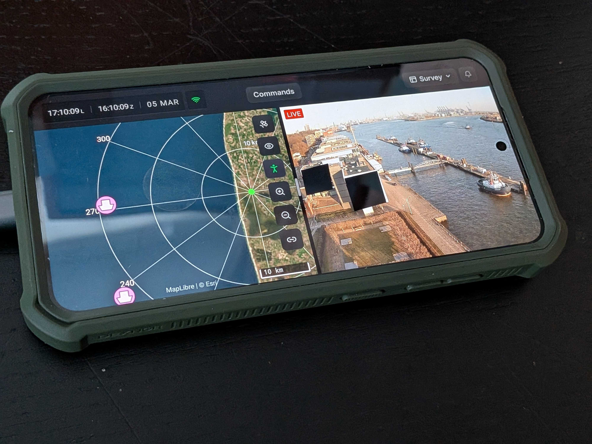

Hydris
======

Like Home Assistant, but for the outdoors. An open-source coordination engine for sensors, assets, and mission systems across large-area networks where things aren't conveniently plugged into a wall.

Integrate once. Deploy everywhere. No vendor lock-in.



Please see [projectqai.github.io](https://projectqai.github.io/) for documentation.

Building and running Hydris locally?:
Requires [Go](https://go.dev) 1.27.3+, [Bun](https://bun.sh), and `make`. Then:

```bash
make setup      # install git hooks + JS deps
make frontend   # build the web UI into view/apps/foss/build
```

Run `make frontend` before building or running the backend: the Go server embeds the web
UI (`//go:embed`), so it won't compile until that build output exists. See
[view/README.md](view/README.md) for the web and Android dev loop.

Then start the server:

```bash
go run .          # serves the app at http://localhost:50051
go run . --view   # same, and opens it in your browser
```

Building for Android
--------------------

Building the Android APK (`make android`) additionally requires:

- JDK 17
- Android SDK Platform 34 (Android 14)
- Android NDK

Install the SDK platform and NDK through Android Studio's **SDK Manager**:

- **SDK Platforms** → Android 14 (API 34)
- **SDK Tools** → **NDK (Side by side)**

Everything the React Native app additionally needs is handled automatically by Expo.

Building the desktop app
------------------------

The desktop app embeds a native webview, so build requirements depend on the target:

- **Linux** (`make desktop_native`) — a C toolchain plus the GTK/WebKit dev headers. On
  Debian/Ubuntu: `build-essential pkg-config libgtk-3-dev libwebkit2gtk-4.1-dev libssl-dev`.
- **Windows** (`make desktop_windows`) — **mingw-w64**, whose resource compiler
  (`x86_64-w64-mingw32-windres`) embeds the app icon and version metadata. The Go build
  itself is pure Go.
 - **Mac** (make desktop_mac) — requires Xcode Command Line Tools to build the native WebKit view helper and HAL dylib (both checked in, rebuild only if changed). Produces an Apple Silicon–only (arm64) Hydris.app, ad-hoc signed, packaged as a zip.

Runtime dependencies
--------------------

The engine shells out to a couple of tools for optional features (it runs fine without
them otherwise):

- **ffmpeg** — video/RTSP bridging and webcam capture.
- **arp** (`net-tools` on Debian/Ubuntu) — only for `--allow-netscan`.
- **clang** Mac needs Xcode Command Line Tools, it's what builds the native WebKit view helper 
